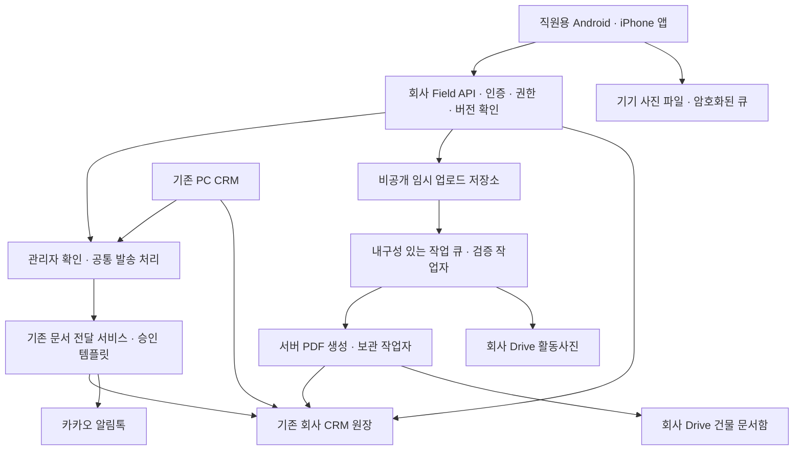
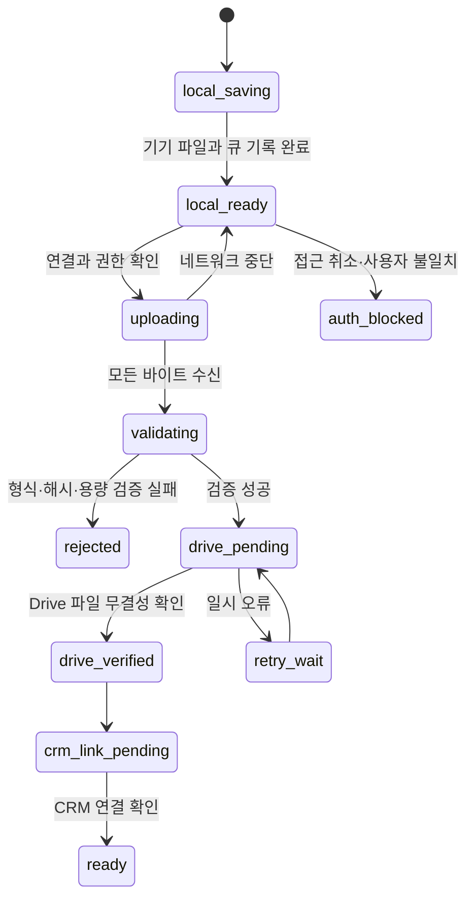

# 현장 앱 아키텍처

기준일: 2026-10-26 · 설계 제안 v1 · 운영 배포 전

## 1. 제품과 화면

직원은 현장에서 업무를 시작해 사진·메모·보고서를 정리한다. 관리자는 같은 앱에서 고객에게 보낼 저장본과 수신자를 최종 확인한다. 회사 계정의 역할만 바꾸거나 직원에게 관리자 권한을 부여하는 방식으로 발송을 열지 않는다.

| 화면 | 핵심 내용 | 주 동작 | 완료 조건 |
|---|---|---|---|
| 로그인·연결 | 회사 CRM 로그인, 권한·연결 상태 | 로그인 | 서버의 활성 사용자·허용 provider·역할 확인 |
| 현장 | 허용된 작업·건물, 오늘·진행 중 작업 | 현장 열기 | canonical buildingId·workOrderId 확정 |
| 촬영 | 구역, 작업 전·중·후, 여러 장 촬영·사진첩 추가 | 촬영 / 다음 구역 | 사진 파일·큐가 기기에 기록됨 |
| 사진 확인 | 구역·단계·포함 여부·메모·업로드 상태 | 분류 수정 / 재시도 | 서버가 사진을 검증하고 Drive·CRM 연결 확인 |
| 보고서 | 작업 정보, 항목 상태, 선택 사진, AI 초안, 직접 수정 | 저장본 만들기 | 확인한 내용의 불변 revision 확정 |
| PDF 확인 | 실제 PDF, 페이지·사진 누락 여부, 보관 단계 | 보관 확인 | 서버 PDF·Drive·CRM 연결 완료 |
| 발송 | 저장본·고객·마스킹 번호·문구·문의번호 | 관리자 최종 발송 | 서버가 동일 저장본·수신자 재검증 |
| 발송 결과 | 요청·처리 중·전달·실패·불명 | 상태 확인 | 공급자 최종 상태 확인, 읽음과 구별 |
| 복구·설정 | 업로드 대기, 실패 단계, 계정·연결 상태 | 이어서 업로드 | 소유 UID와 접근 권한이 여전히 일치 |

하단 주 메뉴는 **현장 / 촬영 / 보고서 / 발송**으로 유지한다. 복구 화면은 각 화면의 동기화 상태에서 연다. 현장 신규 생성은 권한이 허용하는 관리자 흐름으로 한정하고, 임의 주소만 입력해 기존 고객에게 발송하지 않는다.

한 구역에 여러 장을 누적할 수 있다. 작업 전·후가 짝을 이룬다는 UI 안내와 저장 가능 조건은 구별한다. 기존 `work-report-core.js`의 작업 종류별 검증을 공유하므로 모든 공용부 기록에 전후 쌍을 강제하지 않고, 필요한 항목의 누락을 정확히 표시한다. 사진 촬영만으로 완료 처리하지 않는다. 정정·재촬영은 기존 파일을 즉시 덮어쓰지 않고 포함 사진과 보고서 revision을 갱신한다.

## 2. 구성과 책임



| 구성 | 기술 제안 | 경계 |
|---|---|---|
| 모바일 | React Native, TypeScript, Expo Development Build | 카메라·기기 보관·큐·화면. 서비스 비밀키 없음 |
| 로컬 데이터 | SQLite + 검증된 암호화 모듈, OS 보호 파일, SecureStore 키 | 토큰과 사진을 일반 설정 저장소에 넣지 않음 |
| API | 기존 Firebase Functions 코드베이스의 신규 인증 API 모듈 | Auth + App Check + CRM 접근 레코드 + 행위별 권한 |
| 임시 사진 | 기존 비공개 업로드 어댑터와 호환되는 격리 저장 prefix | 앱에 버킷 전역 접근권한·서명 URL을 노출하지 않음 |
| 작업 처리 | 지속 큐 + Node 작업자, 작업 lease·중복 방지 | 메모리 Promise·PC 프로세스에 의존하지 않음 |
| PDF | 회사 템플릿을 출력하는 격리된 서버 Chromium 작업자 제안 | 임의 HTML·외부 URL 실행 금지, 시간·메모리·네트워크 제한 |
| 전달 | 기존 `crm-ai-worker` 문서 전달 기능 | 승인·실제 사용 가능 상태 확인, 기간 제한 보기 링크 |

API·저장소는 가능한 한 기존 회사 프로젝트를 사용한다. 서버 PDF 작업자는 기존 런타임에서 실행 가능성을 먼저 확인하고, 필요한 경우 private Cloud Run/동등 런타임을 추가하는 안이다. **실제 인프라 생성·서비스 계정 위임·과금 활성화는 이 설계의 실행에 포함하지 않는다.** Expo Go만으로 카메라·암호화·App Check·재시작 복구를 검증한 것으로 보지 않는다.

## 3. 기존 코드와 재사용 경계

조사 기준은 `549bdce0`이며 아래는 소스상 기능의 존재를 뜻한다. 운영 서비스 활성·권한·호출 호환성을 확인했다는 뜻은 아니다.

| 기존 위치 | 재사용할 것 | 새로 필요한 것 |
|---|---|---|
| `desktop-crm/src/work-report-core.js` | 작업 종류·항목·검증·정규화 | 플랫폼 독립 모듈 추출과 회귀 검증 |
| `desktop-crm/src/work-report-owner-pdf.js`, `work-report-pdf.js` | 고객용 템플릿·표현 규칙 | 서버 출력 어댑터·폰트·사진 읽기 |
| `desktop-crm/src/main.js` | 기존 PDF·보관 orchestration의 동작 기준 | Electron `printToPDF` 의존 제거/대체 |
| `desktop-crm/src/work-report-archive.js` | 건물·고객·보고서 binding, 저장본·발송 검증 | 서버 인증 컨텍스트·공통 claim과 연결 |
| `desktop-crm/src/saved-customer-document-pdf.js` | PDF 12 MiB 제한, 형식·SHA-256·크기 확인 | 서버에서도 동일 규칙 적용 |
| `desktop-crm/src/remote.js` | `crmCompany/workReports`·문서 원장 호환 | revision 충돌·최소 필드 조회 API |
| `company-site/app/field/lib/offline-queue.ts` | UID별 큐, 안정 ID, 복구 개념 | IndexedDB·Blob 대신 native 파일·SQLite |
| `functions/src/drive/` | generation 고정, 폴더·업로드·재시도 어댑터 | 활동사진용 루트·binding·위임 권한 검증 |
| `functions/src/auth/crm-drive-oauth.ts` | 토큰 봉인·사용자 확인 패턴 | 데스크톱 loopback redirect를 모바일에 그대로 사용하지 않음 |
| `crm-ai-worker/src/privacy.js`, 사진·보고서 처리 | 텍스트 마스킹·입력 제한·초안 정책 | 허용된 모바일 사진만 전달하는 server façade |
| `crm-ai-worker/src/document-delivery.js` | 승인 템플릿·문서 보안·공급자 상태 | PC·모바일 공통 권한·원자적 중복 방지 확인 |

기존 웹 현장앱의 광고 매물 DB·폴더와 이번 관리 작업사진은 분리한다. `kr.co.bringengineering.crm` 데스크톱 app ID, 기존 업데이트 채널·버전 예약 공간도 모바일과 공유하지 않는다. 제안 모바일 식별자는 `kr.co.bringengineering.fieldnotes`이며 스토어 중복·회사 소유 확인 후 확정한다.

## 4. 인증·권한

로그인 성공만으로 권한을 부여하지 않는다. API는 ID token 서명·issuer·audience·만료/취소, 검증된 이메일, 허용 provider, 서버 access 레코드의 UID·이메일·enabled·mustChangePassword·역할을 확인한다. 퇴사·비활성·암호변경 필요·허용되지 않은 마케팅 전용 계정은 거부한다. App Check는 앱 무결성 신호이며 사용자 권한을 대체하지 않는다. iOS·Android 실제 attestation을 사용하고 운영 debug bypass는 두지 않는다.

| 동작 | 관리자 | 일반 직원(member) | viewer·외부·미등록 |
|---|---|---|---|
| 현장 목록 | 허용된 회사 범위 | 서버가 허용한 배정 범위 | 첫 버전 사용 불가 |
| 사진·메모 작성 | 허용 현장 | 본인/팀의 허용 방문 | 불가 |
| 결과보고서 보관 | 허용 현장 | 본인/팀의 허용 방문 | 불가 |
| 관리자에게 확인 요청 | 가능 | 가능 | 불가 |
| 고객 발송 미리보기·실제 발송 | 가능 | 불가 | 불가 |
| 타 직원의 임시 원본·큐 열람 | 별도 서버 권한 필요 | 불가 | 불가 |
| Drive 루트·회사 연결 변경 | 별도 관리 승인 | 불가 | 불가 |

배정 정보가 없는 작업의 직원 접근을 임의로 전체 허용하지 않는다. 기존 작업·팀 레코드의 실제 관계를 M0에서 확인하고, 명시적 할당이 없으면 관리자 확인을 거친다. 모바일 필터는 UX일 뿐이며 API가 모든 ID 접근을 다시 검증한다.

프로젝트 주의: 현재 소스 `.firebaserc`와 웹 Firebase client는 `bring-fm`을 가리키지만, 제공된 SECURITY 가이드는 CRM·workflow의 `bring-fm-hj`와 signage `bring-fm`을 구별한다. 따라서 이 문서는 운영 대상 프로젝트를 단정하거나 규칙을 복사하지 않는다. **실제 현재 CRM 인증 issuer·DB·배포 대상의 소유·매핑 확인을 M0의 필수 조건**으로 둔다. 이전 문서의 프로젝트 이름만으로 배포하지 않는다.

## 5. 데이터와 CRM 호환

아래 `fieldMobile/*`는 제안용 논리 이름이다. 실제 루트·서버 전용 경로는 기존 DB 규칙 검토 후 결정하며, 클라이언트가 임의로 직접 쓸 수 있는 경로를 만들지 않는다.

| 엔티티 | 핵심 필드 | 연결·불변성 |
|---|---|---|
| Visit | visitId, ownerUid, memberUids, buildingId, workOrderId, workDate, revision | 서버가 확인한 CRM 건물·작업, 날짜는 Asia/Seoul |
| Photo | photoId, visitId, itemKey, phase, captureTime, hash, bytes, serverState | `before/during/after`, canonical photo ID 유지 |
| Upload | uploadId, photoId, ownerUid, receivedBytes, lease, generation, safeErrorCode | 내부 세션 URL·임시 경로는 server-only |
| ReportRevision | revisionId, reportId, visitRevision, contentHash, schemaVersion, content | 확정 이후 수정 금지, 수정은 새 revision |
| Artifact | artifactId, revisionId, driveFileId, sha256, size, archiveState, renderVersion | 기존 savedCustomerDocument 레코드에 연결 |
| ReviewRequest | requestId, revisionId, artifactId, requesterUid, state | 실제 발송과 구별, 고객에게 전송되지 않음 |
| Delivery | deliveryId, artifactId, revisionId, canonicalCustomerId, bindingHash, status | 수신 번호·템플릿은 서버가 결정 |
| Operation | operationId, type, targetId, state, lease, safeErrorCode | 비동기 작업 재조회·중복 실행 방지 |

기존 CRM `workReports`와 `buildingDocuments`가 고객용 기준 원장이다. 새로운 원장을 병렬로 만들어 PC에 보이지 않는 보고서를 만들지 않는다. draft/revision/job은 별도 server-owned 데이터로 보충하고, artifact 보관 완료 시 기존 `savedCustomerDocument` 형식·보고서 `updatedAt`·Drive file ID·SHA-256·크기를 맞춰 연결한다. 실제 키와 저장 모양은 기존 canonical mutation 경로를 확인 후 정한다.

PC나 다른 휴대폰에서 같은 방문을 수정하면 `expectedRevision` 불일치로 409를 반환한다. 사진·메모는 로컬에 남기고 최신본 비교 화면을 제공한다. 두 번째 수정으로 첫 번째 내용을 조용히 덮어쓰지 않는다. 발송 직전 수신 고객/번호나 보고서 revision이 바뀌면 저장본·미리보기를 다시 확인한다.

## 6. 사진 저장과 오프라인



1. 카메라의 cache URI를 영구 원본으로 취급하지 않는다. 앱 문서 저장 영역으로 파일을 확정하고 로컬 큐를 기록한 뒤에만 ‘기기 저장 완료’를 표시한다. 중간 종료의 고아 파일·미완료 row를 다음 실행에서 복구한다.
2. 큐에는 random photoId, 소유 UID, 방문 ID, 구역·단계·크기·해시·상대 파일 경로를 기록한다. 절대 iOS sandbox 경로를 영구 식별자로 쓰지 않는다.
3. 기기 파일과 DB의 암호화 키는 OS 보호 저장소로 관리한다. SecureStore 자체가 모든 사진·SQLite를 암호화해 준다고 가정하지 않는다. native 파일 암호화·DB 모듈의 실기기 검증을 거친다. 자동 클라우드 백업에 작업사진·토큰·큐를 포함하지 않는다.
4. 온라인에서 사진 업로드를 예약한다. 앱은 인증된 chunk API에 바이트를 보내며 private staging에서 검증한다. 메타데이터만 보고 성공 처리하지 않는다.
5. 서버가 검증된 파일을 회사 Drive 활동사진으로 전송한다. Drive 실제 ID·size·checksum과 서버 콘텐츠 hash를 확인하고 CRM photo 연결을 마쳐야 `ready`다.
6. 앱이 재시작하면 local row와 서버 upload offset·operation을 조회해 이어간다. 자동 background 실행은 OS가 허용한 범위의 최선 노력이며, 강제 종료 뒤 실행을 보장하지 않는다. 재실행 복구를 기본 보장으로 삼는다.
7. 저장소 부족·권한 거부·인증 만료·네트워크 오류를 구별한다. `ready` 전 원본은 자동 삭제하지 않는다. 기기 정리 정책은 직원에게 표시하고, 미전송 자료의 삭제는 명시적 확인을 거친다.

MVP 제안 한도: 사진 JPEG/PNG, 한 장 20 MiB·decoded 40 MP 이하, 한 방문 100장, 동시 2장 업로드, chunk 1 MiB. iPhone HEIC를 선택하면 지원된 native decoder로 JPEG 변환 후 동일 검증을 받으며 실패 시 원본을 보존한다. 영상·GIF·SVG·압축 파일은 첫 버전 대상이 아니다. 값은 구현 시 기존 가장 엄격한 한도와 기기·서버 메모리 시험에 맞춰 조정한다. PDF는 기존의 12 MiB 제한을 유지한다.

확장자와 matching MIME, magic bytes, 실제 decoded 크기, 안전 파일명·메타데이터 길이를 서버에서 모두 확인한다. EXIF 위치와 기기 식별 정보는 기본 제거하고 작업일·촬영 시각만 필요한 범위에서 보존한다. 기기 날짜를 서버 시각처럼 신뢰하지 않는다.

재시도는 전송·검증·보관의 명확한 실패 단계에만 적용하고 지수 지연·jitter·횟수/전체 시간 한도를 둔다. 파일 하나가 실패해도 이미 `ready`인 파일을 재업로드하지 않는다. 동일 방문·photoId의 반복 요청은 동일 binding·hash에서만 재사용하며 값이 바뀌면 409다.

## 7. Drive 보관

기존 회사 Drive 루트를 관리자 설정에서 서버가 해석한다. 앱은 임의 folder ID·Drive URL·공개 공유 설정을 전송할 수 없다.

```text
회사에서 지정한 활동사진 루트/
  {기존 건물 폴더}/
    {YYYY-MM-DD}_{작업 종류}_{visitId 짧은 값}/
      {항목 키}/
        작업전/ · 작업중/ · 작업후/

회사에서 지정한 건물 문서함 루트/
  CRM 발송 문서/작업 결과보고서/{YYYY}/
    {기존 saved document ID}.pdf
```

표시는 건물·작업 이름, 실체 식별은 canonical ID와 속성으로 한다. 기존 폴더 매핑·허용 범위를 먼저 재사용하고 이름만으로 폴더를 합치지 않는다. Drive `appProperties`는 키+값 124바이트 한도를 지켜 긴 식별자를 안정 hash로 정규화한다. 전달 개인정보를 파일명에 넣지 않는다.

Google OAuth·resumable URL·Drive 서비스 자격은 서버의 승인된 connector와 비밀 저장소에서 처리한다. 기존 데스크톱의 개인별 봉인 토큰을 회사 공용 토큰으로 바꿔 재사용하지 않는다. 기존 root를 다룰 OAuth 범위와 회사 소유권은 관리자가 검토해야 하며, `drive.file`만으로 임의 기존 폴더에 접근된다고 가정하지 않는다. 공유 Drive와 개인 My Drive는 어댑터·권한·quota를 따로 검증한다. 회사 connector 사용을 위해 새 위임이나 공유 변경이 필요하면 별도 승인 대상으로 둔다.

임시 파일은 비공개·짧은 보관으로 운영하고 Drive 검증·CRM 연결 이후 정리한다. 제안 값은 완료 뒤 24시간, 미완료 뒤 7일이며 보관 정책·비용 검토 후 확정한다. 앱에는 파일 세션 URL·서버 임시 경로·인증정보를 반환하거나 기록하지 않는다.

## 8. 보고서·AI·발송

PDF 작업은 `requested → rendering → drive_archiving → crm_linking → ready`로 표시한다. CRM에 원본이 저장됐어도 PDF 보관이 실패하면 단계와 복구 동작을 구별한다. 재시도는 같은 revision과 artifact 키를 사용해 원본 보고서를 반복 생성하지 않는다.

AI에는 사용자가 선택하고 서버가 검증한 사진·공개 가능한 작업 메모만 보낸다. 내부 메모·연락처·열쇠·출입정보·계좌·업체 원가와 이익은 제외한다. 프롬프트와 사진/문서는 지시가 아닌 자료다. 작업 종류별 상태·완료 여부는 CRM 기록과 직원 확인을 근거로 하며, 사진만으로 자동 완료하지 않는다. AI 없이 직접 작성·저장도 가능해야 한다.

관리자 발송은 다음 순서를 고정한다.

1. report revision과 모든 선택 사진이 `ready`, PDF·Drive·CRM 연결이 완료됐는지 확인한다.
2. 서버가 건물→고객→기존 등록 연락처를 해석한다. 앱이 임의 입력한 수신 번호는 받지 않는다.
3. 승인된 `BRINGCOMPLETIONREPORTV3` 본문·WL 버튼·현재 사용 가능 상태를 확인한다. 문의는 **1551-3873**이다.
4. 미리보기의 artifact hash·revision·수신 binding·템플릿 fingerprint를 짧은 유효기간에 묶는다. 관리자가 최종 확인한다.
5. PC·모바일이 공유하는 서버 claim에서 단 한 건을 획득한 뒤 기존 전달 서비스에 보낸다. 외부 호출 전 claim을 내구성 있게 남긴다.
6. 접수·처리 중·전달 완료·실패·불명을 구별한다. 읽음으로 표시하지 않는다. 결과 불명·timeout 뒤 재발송하거나 새 키를 만들지 않고 같은 deliveryId를 조회한다.

현재 Worker의 KV 캐시만으로 PC·휴대폰 동시 발송에 대한 전역 원자성이 보장된다고 단정하지 않는다. 서버 공통 claim과 공급자 키의 실제 동시성 시험이 필요하다. 기존 PC가 별도 발송 경로로 우회하지 않도록 양쪽 전환·최소 호환 버전·DB 쓰기 정책을 검증한 뒤 모바일 고객 발송을 활성화한다. 필요 규칙 변경은 별도 승인·백업·롤백 계획을 갖춘다.

발송한 PDF는 불변 이력으로 보존한다. 재촬영이나 본문 수정은 새 revision·새 저장본이 되며 이전 고객 링크를 조용히 다른 PDF로 바꾸지 않는다. SMS 자동 대체·예약 자동 발송은 첫 버전에 넣지 않는다.

## 9. 오류·운영

| 상황 | 처리 |
|---|---|
| 사진 촬영 뒤 통신 끊김 | 기기 보관, 연결 시 같은 photoId로 재개 |
| 사진 전송 끝·응답 유실 | upload 상태 조회 후 finalize, 다시 파일 생성하지 않음 |
| Drive 완료·CRM 연결 실패 | 같은 Drive file ID를 재사용해 연결 단계만 복구 |
| PDF 완료·DB 연결 실패 | artifact hash로 재조회, 새로운 PDF 무분별 생성 금지 |
| 편집 충돌 | 409·비교 UI, 로컬 수정본 보존 |
| 퇴사·접근 취소 | 업로드·AI·PDF·발송 중단, 다른 UID로 큐 이전 금지 |
| Google 권한/쿼터 오류 | 연결·권한·제한의 안전 코드, 반복 로그인 유도 금지 |
| 카카오 접수 응답 불명 | `unknown`, 같은 요청 조회만 수행 |
| 앱 삭제·기기 분실 | 미업로드 파일 복구 보장 불가, 미전송 수를 명확히 표시 |

운영 로그는 opaque ID·단계·HTTP 분류·안전 원인 코드·시간·바이트수만 남긴다. 원문 메모·전체 번호·이메일·사진·OAuth/ID token·보안 문서 URL·업로드 URL을 로그·분석 SDK·crash 첨부로 보내지 않는다. 알림 push를 추가할 경우 사진·주소·고객명을 payload에 넣지 않는다.

## 10. 공식 기술 자료

다음은 플랫폼 제약 확인용이며 이 설계의 구현·운영 확인을 대신하지 않는다. 2026-10-26 확인.

- [Expo Development Builds](https://docs.expo.dev/develop/development-builds/introduction/): 필요한 native 모듈을 포함한 앱으로 검증한다.
- [Expo Camera](https://docs.expo.dev/versions/latest/sdk/camera/): Android·iOS 카메라와 촬영 파일 처리.
- [Expo FileSystem](https://docs.expo.dev/versions/latest/sdk/filesystem/), [SQLite](https://docs.expo.dev/versions/latest/sdk/sqlite/), [SecureStore](https://docs.expo.dev/versions/latest/sdk/securestore/): 파일·큐·키 보관은 각 책임을 구별한다.
- [Expo BackgroundTask](https://docs.expo.dev/versions/latest/sdk/background-task/): OS 스케줄링 제약 때문에 즉시/강제 종료 후 실행을 보장하지 않는다.
- [Google Drive upload](https://developers.google.com/workspace/drive/api/guides/manage-uploads): resumable 재개와 세션 만료를 처리한다.
- [Firebase backend App Check 검증](https://firebase.google.com/docs/app-check/custom-resource-backend): 앱 검증과 사용자 권한을 함께 적용한다.
